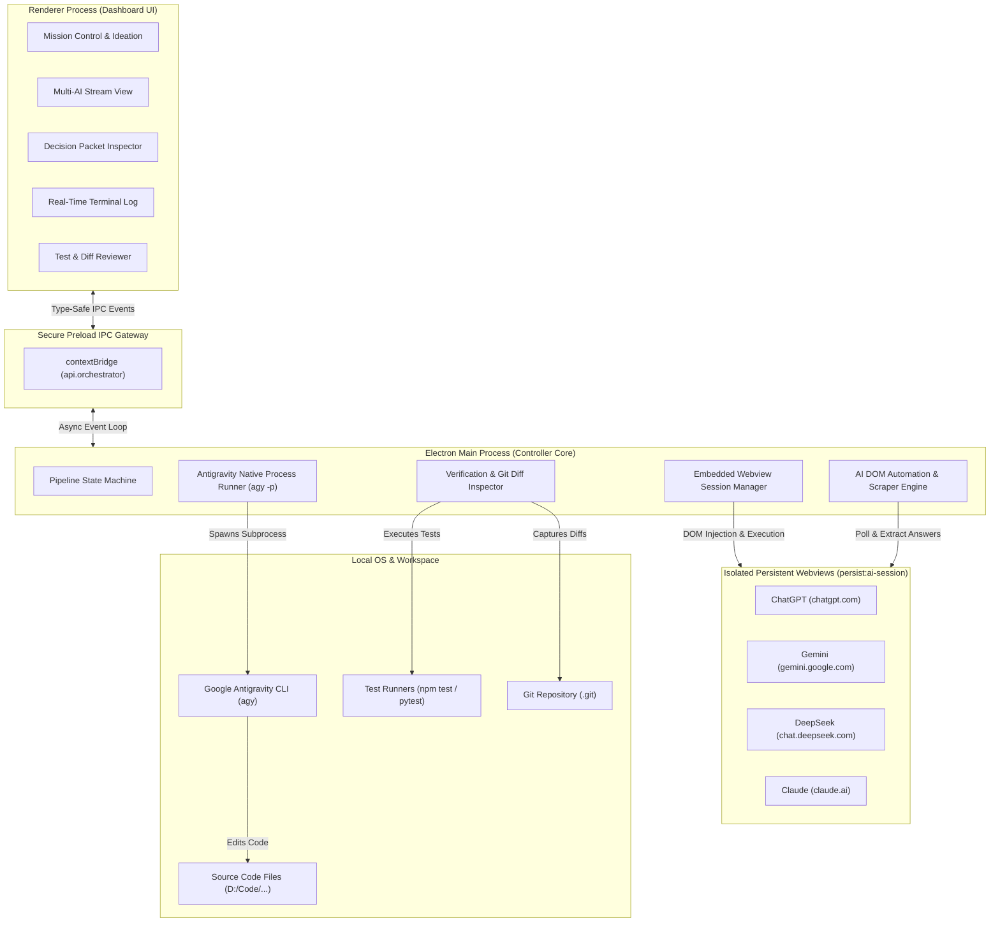

# 🚀 Multi-AI Autonomous Development Controller (Desktop App)
## Software Requirements Specification (SRS) & System Architecture Blueprint

> **Status:** Approved Architecture & Specification Document  
> **Target Platform:** Windows 10/11 Desktop Application  
> **Technology Stack:** Electron 35+, Node.js 22+, React 19 / TypeScript, Antigravity CLI (`agy`)  
> **Author:** Antigravity AI Engineering Team  
> **Date:** October 2026  

---

## 1. Executive Summary & Core Objective

The **Multi-AI Autonomous Development Controller** is a 100% cost-free, zero-API-key desktop workstation application that coordinates multiple state-of-the-art AI systems into an autonomous software engineering feedback loop. 

Instead of treating AI models as disconnected chat interfaces or simple text generators, this application orchestrates them as specialized roles in a production development workflow:
1. **ChatGPT:** Lead Software Architect & System Decomposer.
2. **Google Gemini:** Feasibility, Infrastructure & UX Edge-Case Reviewer.
3. **DeepSeek:** Code Specialist, Data Structures, Algorithms & Strict Test Designer.
4. **Claude (Opt-In):** Senior Code Security & Quality Auditor (Free-tier Quota Protected).
5. **Relay Synthesizer:** Reconciles debates into a deterministic **Decision Packet**.
6. **Google Antigravity:** Native local OS implementation agent running `agy -p "<task>" --json` in the user's workspace.
7. **Test Verification Harness:** Spawns native test suites (`npm test`, `pytest`, compiler diagnostics) and extracts Git diff evidence.
8. **AI Closed-Loop Reviewer:** Feeds real execution proof back to ChatGPT/Claude for verification (`APPROVED: TRUE/FALSE`), triggering an automated corrective loop if issues arise.

---

## 2. Technology Stack & Framework Decision

### Why Electron (and Why Tauri Was Explicitly Rejected)

| Requirement / Dimension | **Electron (Selected)** | **Tauri (Rejected)** | Architectural Justification |
| :--- | :--- | :--- | :--- |
| **Language Knowledge** | 100% JavaScript / TypeScript | Rust Backend + JS Frontend | The user has no Rust knowledge. Electron allows the entire application (Main, Preload, Renderer, Automation) to be written in standard TypeScript/Node.js. |
| **Embedded AI Sessions** | Native Chromium WebContents & WebViews with isolated/persistent partitions (`persist:ai-session`) | Windows WebView2 with restricted automation APIs | Electron allows full DOM manipulation, cookie persistence, and background session isolation out of the box. |
| **Child Process Spawning** | Node.js `child_process.spawn` with stream piping | Rust `std::process` interop via IPC | Spawning `agy -p` with real-time log streaming and Windows job management is native in Node.js. |
| **Debugging Ergonomics** | Chrome DevTools for both Main and Renderer processes | Mixed Rust debugger + WebView DevTools | Eliminates cross-language debugging friction. |

---

## 3. High-Level System Architecture

The desktop application uses Electron's multi-process architecture with strict IPC isolation and specialized subsystem roles.



---

## 4. The Autonomous Closed-Loop Sequence

```mermaid
sequenceDiagram
    autonumber
    actor User as Developer
    participant UI as Desktop Dashboard
    participant Orchestrator as Electron Controller
    participant Webviews as Embedded Multi-AI (ChatGPT/Gemini/DeepSeek)
    participant Agy as Google Antigravity (agy -p)
    participant Git as OS Workspace & Git

    User->>UI: Enter Requirement & Target Workspace
    UI->>Orchestrator: startPipeline({ idea, workspace })
    
    rect rgb(20, 30, 45)
        note over Orchestrator,Webviews: Phase 1: Multi-AI Planning Debate
        Orchestrator->>Webviews: Dispatch Turn 1 (ChatGPT: Architect Plan)
        Webviews-->>Orchestrator: ChatGPT Plan Streamed
        Orchestrator->>Webviews: Dispatch Turn 2 (Gemini: Feasibility Critique)
        Webviews-->>Orchestrator: Gemini Critique Streamed
        Orchestrator->>Webviews: Dispatch Turn 3 (DeepSeek: Code & Test Spec)
        Webviews-->>Orchestrator: DeepSeek Code Analysis Streamed
    end

    rect rgb(30, 40, 30)
        note over Orchestrator,UI: Phase 2: Decision Packet Synthesis
        Orchestrator->>Webviews: Dispatch Synthesis Prompt to ChatGPT
        Webviews-->>Orchestrator: Markdown Decision Packet
        Orchestrator->>UI: Render Decision Packet (Tasks, Criteria, Decisions)
    end

    rect rgb(45, 35, 20)
        note over Orchestrator,Git: Phase 3: Antigravity Code & Test Execution
        Orchestrator->>Agy: agy -p "<packet directive>" --json
        Agy->>Git: Write Files & Run Refactor
        Agy-->>Orchestrator: CLI Completion Output
        Orchestrator->>Git: Run Verification: npm test
        Git-->>Orchestrator: Test Exit Code, stdout, stderr
        Orchestrator->>Git: git diff --stat & git diff (Source only)
        Git-->>Orchestrator: Git Diff Summary
    end

    rect rgb(40, 20, 40)
        note over Orchestrator,Webviews: Phase 4: Closed-Loop AI Verification
        Orchestrator->>Webviews: Dispatch Real Evidence to ChatGPT Verifier
        Webviews-->>Orchestrator: Review Response (APPROVED: TRUE/FALSE)
        alt Approved == TRUE
            Orchestrator->>UI: Update Stage: COMPLETE_VERIFIED
            UI-->>User: Notification: Feature Complete & Verified!
        else Approved == FALSE and Iteration < MaxRetries
            Orchestrator->>Agy: Corrective agy task with error logs
            note over Orchestrator,Agy: Re-run Execution & Re-test
        end
    end
```



---

## 5. Software Requirements Specification (SRS)

### 5.1 Functional Requirements (FR)

* **FR-1: One-Time Persistent Login:** The application shall embed ChatGPT, Gemini, DeepSeek, and Claude inside partitioned webviews (`persist:ai-session`). The user logs in exactly once; cookies, tokens, and storage shall persist indefinitely across app restarts.
* **FR-2: Visual / Headless Mode Switch:** The user can toggle between viewing the live webview panels (to watch typing, solve any unexpected Cloudflare turnstiles, or inspect tabs) and hiding them in background automation mode.
* **FR-3: Model Participation Selection:** The user can enable or disable individual models per run (`[✓] ChatGPT`, `[✓] Gemini`, `[✓] DeepSeek`, `[ ] Claude`). Claude shall have an explicit "Quota-Protected" opt-in indicator.
* **FR-4: Rate-Limit & Token Budgeting:**
  * Prompts shall enforce token distillation (sending synthesized outlines rather than cumulative multi-thousand-word chat histories).
  * The engine shall scan DOM elements for rate-limit banners (e.g. *"out of free messages"*). If detected, it shall trigger an automatic circuit-breaker to bypass that provider without crashing.
* **FR-5: Deterministic Decision Packet Synthesis:** The orchestrator shall parse multi-AI discussions into a structured object containing:
  * System Architecture Decisions
  * Implementation Tasks with target file paths
  * Test Runner Commands (`npm test`, `pytest`)
  * Non-negotiable Acceptance Criteria
* **FR-6: Antigravity CLI Execution (`agy -p`):** The application shall execute `agy -p "<directive>" --json` in the specified workspace with real-time stdout/stderr streaming to the dashboard terminal.
* **FR-7: Real Execution Evidence Collection:** After code implementation, the engine shall automatically:
  * Run the specified test suite and capture the exit code.
  * Extract the tail of stdout/stderr (focusing on pass/fail assertions and error stacks).
  * Run `git diff --stat` to measure code changes.
* **FR-8: Automated AI Review Loop:** The engine shall format the evidence into a verification prompt for ChatGPT/Claude. If rejected, it shall automatically generate a corrective prompt and re-invoke Antigravity up to `maxRetries` (1 to 5).

### 5.2 Non-Functional Requirements (NFR)

* **NFR-1 (100% Free):** Must operate exclusively against the user's free web sessions. Zero paid API keys (OpenAI, Anthropic, Google AI Studio) allowed.
* **NFR-2 (Non-Interference):** The application must never kill or interfere with the user's daily Google Chrome browser processes.
* **NFR-3 (Process Safety):** If the application closes, all spawned background subprocesses (`agy`, node test runners) must be gracefully terminated using Windows process job handles.
* **NFR-4 (Evidence Brevity):** Test logs and git diffs sent to AI review prompts must be compressed to `< 1,500` characters to prevent context bloat and rate-limit exhaustion.

---

## 6. Detailed Component Design & Specifications

### 6.1 Embedded Webview Automation Engine (`webview-driver.ts`)

Instead of remote CDP ports that conflict with Chrome, Electron creates embedded `<webview>` instances with `partition="persist:multi-ai-session"`.

```typescript
export interface WebviewProviderConfig {
  id: 'chatgpt' | 'gemini' | 'deepseek' | 'claude';
  name: string;
  url: string;
  composerSelector: string;
  submitSelector: string;
  responseSelector: string;
  stopSelector: string;
  rateLimitRegex: RegExp;
}

export const PROVIDER_CONFIGS: Record<string, WebviewProviderConfig> = {
  chatgpt: {
    id: 'chatgpt',
    name: 'ChatGPT',
    url: 'https://chatgpt.com',
    composerSelector: '#prompt-textarea, div[contenteditable="true"]',
    submitSelector: 'button[data-testid="send-button"], button[aria-label*="Send" i]',
    responseSelector: '[data-message-author-role="assistant"], .markdown',
    stopSelector: 'button[data-testid="stop-button"], button[aria-label*="Stop" i]',
    rateLimitRegex: /you've reached your limit|too many requests/i
  },
  gemini: {
    id: 'gemini',
    name: 'Gemini',
    url: 'https://gemini.google.com/app',
    composerSelector: 'div.ql-editor, textarea, div[role="textbox"]',
    submitSelector: 'button.send-button, button[aria-label*="Send" i]',
    responseSelector: 'model-response, message-content, .model-response-text',
    stopSelector: 'button[data-test-id="stop-button"], button[aria-label*="Stop" i]',
    rateLimitRegex: /rate limit reached|temporarily unavailable/i
  },
  deepseek: {
    id: 'deepseek',
    name: 'DeepSeek',
    url: 'https://chat.deepseek.com',
    composerSelector: '#chat-input, textarea.chat-input, textarea',
    submitSelector: 'div[role="button"][aria-label*="Send" i], button.send-btn',
    responseSelector: '.ds-markdown, [class*="ds-markdown"]',
    stopSelector: 'button[aria-label*="Stop" i], .ds-stop-btn',
    rateLimitRegex: /server is busy|limit reached/i
  },
  claude: {
    id: 'claude',
    name: 'Claude',
    url: 'https://claude.ai',
    composerSelector: 'div[contenteditable="true"].ProseMirror, div[role="textbox"]',
    submitSelector: 'button[aria-label*="Send message" i], button[aria-label*="Send" i]',
    responseSelector: '[data-message-author-role="assistant"], .font-claude-message',
    stopSelector: 'button[aria-label*="Stop Response" i]',
    rateLimitRegex: /out of free messages|message limit reached|resets at/i
  }
};
```

### 6.2 Antigravity Process Runner (`antigravity-runner.ts`)

```typescript
export interface ExecutionEvidence {
  success: boolean;
  exitCode: number;
  stdoutTail: string;
  stderrTail: string;
  changedFiles: string[];
  diffStat: string;
  durationMs: number;
}

export async function runAntigravityTask(
  taskPrompt: string,
  workspace: string,
  testCommand: string,
  onLog: (chunk: string) => void
): Promise<ExecutionEvidence> {
  // 1. Spawns `agy -p "<taskPrompt>" --json` in target workspace
  // 2. Streams real-time terminal output to UI
  // 3. Runs specified verification test command (e.g. `npm test`)
  // 4. Extracts `git status --porcelain` and `git diff --stat`
  // 5. Returns truncated evidence object for AI review
}
```

---

## 7. Interactive UI/UX Layout Specification

```
┌────────────────────────────────────────────────────────────────────────────────────────┐
│  ⚡ MULTI-AI AUTONOMOUS CONTROLLER                                    [—] [口] [✕]      │
├────────────────────────────────────────────────────────────────────────────────────────┤
│  [● ChatGPT: OK]   [● Gemini: OK]   [● DeepSeek: OK]   [● Claude: OK]   [agy CLI: v1.2]│
├────────────────────────────────┬───────────────────────────────────────────────────────┤
│  🎯 MISSION CONTROL            │  💻 EXECUTION & WORKSPACE                              │
│                                │  ┌──────────────────────────────────────────────────┐ │
│  Project Goal / Requirement:   │  │ [📋 Decision Packet] [🧪 Evidence] [💻 Terminal] │ │
│  ┌───────────────────────────┐ │  ├──────────────────────────────────────────────────┤ │
│  │ Add dark mode theme toggle│ │  │ # DECISION PACKET: Dark Mode Toggle             │ │
│  │ with localStorage and unit│ │  │                                                  │ │
│  │ tests in Header component.│ │  │ ## Agreed Architecture:                          │ │
│  └───────────────────────────┘ │  │ • Use CSS variable tokens in globals.css         │ │
│                                │  │ • Custom useTheme hook with storage fallback     │ │
│  Workspace: [ D:\Code\Project] │  │                                                  │ │
│  Max Retries: [ 3 ]            │  │ ## Implementation Tasks:                         │ │
│                                │  │ 1. Task: ThemeContext & Provider (src/context)   │ │
│  Participating Models:         │  │ 2. Task: Header Switch Component (src/components)│ │
│  [✓] ChatGPT   [✓] Gemini      │  │                                                  │ │
│  [✓] DeepSeek  [ ] Claude      │  │ ## Acceptance Criteria:                          │ │
│                                │  │ • npm test passes with exit code 0               │ │
│  [ 🚀 START PIPELINE ]  [⏹ STOP]│  │ • Zero TypeScript compiler warnings             │ │
│                                │  └──────────────────────────────────────────────────┘ │
│  ───────────────────────────── │  LIVE PROCESS TERMINAL:                               │
│  💬 MULTI-AI DISCUSSION STREAM │  ┌──────────────────────────────────────────────────┐ │
│  ┌───────────────────────────┐ │  │ [10:14:02] agy -p "Implement Decision Packet"    │ │
│  │ [CHATGPT - Architect]     │ │  │ [10:14:15] Modified: src/components/Header.tsx   │ │
│  │ Proposed component state..│ │  │ [10:14:28] Running: npm test                     │ │
│  │                           │ │  │ PASS src/components/Header.test.tsx (4 tests)    │ │
│  │ [GEMINI - Feasibility]    │ │  │ Exit Code: 0 (SUCCESS)                           │ │
│  │ Check SSR hydration flash!│ │  │ [10:14:35] ChatGPT Review: APPROVED: TRUE        │ │
│  └───────────────────────────┘ │  └──────────────────────────────────────────────────┘ │
└────────────────────────────────┴───────────────────────────────────────────────────────┘
```

---

## 8. Step-by-Step Implementation Roadmap

1. **Step 1: Scaffolding the Electron Project:**
   - Initialize `package.json` with Electron 35, TypeScript, Vite/React.
   - Configure `electron-builder` for native Windows executable generation.
2. **Step 2: Main Process & IPC Gateway Setup:**
   - Create `src/main/main.ts` with window management and lifecycle hooks.
   - Configure `src/main/preload.ts` with type-safe `contextBridge`.
3. **Step 3: Embedded Webview Session Manager:**
   - Implement `src/main/webview-manager.ts` creating persistent webview sessions (`persist:ai-session`).
   - Create automation preload script for ChatGPT, Gemini, DeepSeek, and Claude.
4. **Step 4: Antigravity Subprocess & Git Test Harness:**
   - Implement `src/main/antigravity-runner.ts` to spawn `agy -p` with Windows job kill safety.
   - Add test runner execution and diff stat parsing.
5. **Step 5: Pipeline State Machine & AI Closed-Loop:**
   - Implement orchestration loop: Debate $\rightarrow$ Synthesis $\rightarrow$ Antigravity Execution $\rightarrow$ Test $\rightarrow$ Verification.
6. **Step 6: UI Dashboard Implementation:**
   - Build Mission Control, Stream Feed, Decision Inspector, and Real-Time Terminal.
7. **Step 7: Verification & Packaging:**
   - Execute end-to-end smoke test, verify persistent logins, and compile final standalone Windows binary.
